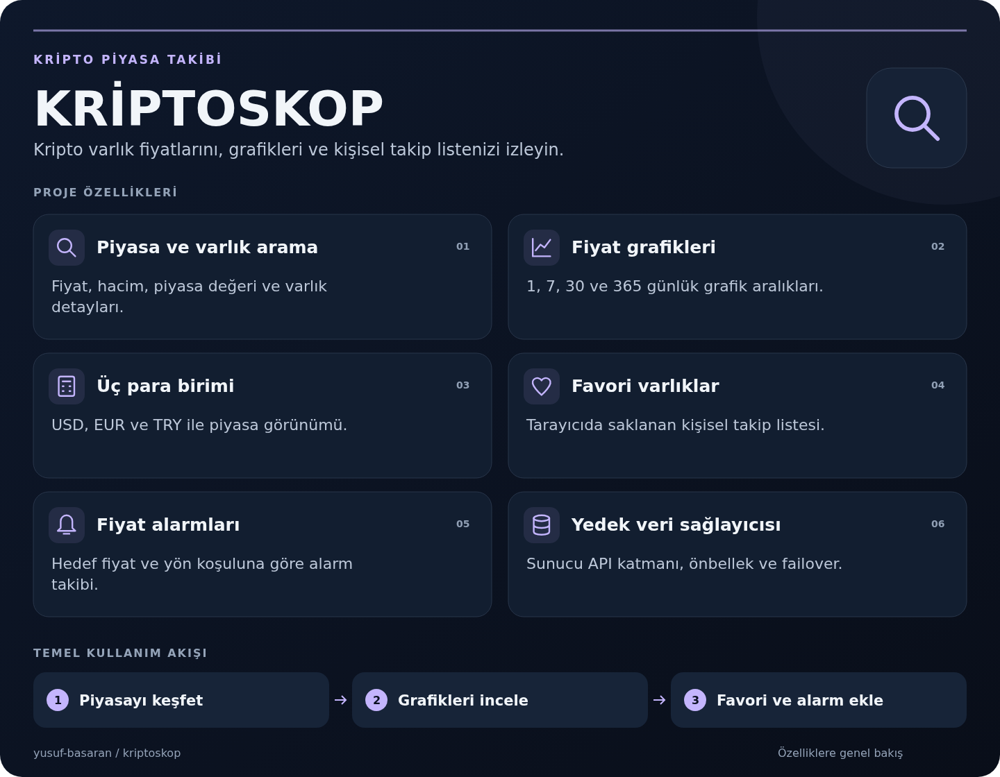

# KRİPTOSKOP

Tarayıcı arayüzü veriyi yalnızca aynı origin üzerindeki `/api/*` Vercel Functions adreslerinden alır. Sunucu CoinGecko Demo API'sini dener; istek limiti, ağ, timeout veya servis hatasında CoinPaprika'ya geçer. Tarayıcıya API anahtarı gönderilmez.

<!-- project-overview:start -->
## Projeye genel bakış



[Görseli büyük aç](docs/images/project-overview.png) · [SVG kaynağı](docs/images/project-overview.svg)

<details>
<summary>Görseldeki özellikler ve ilgili kaynaklar</summary>

- **[Piyasa ve varlık arama](js/main.js)** — Fiyat, hacim, piyasa değeri ve varlık detayları.
- **[Fiyat grafikleri](js/chart.js)** — 1, 7, 30 ve 365 günlük grafik aralıkları.
- **[Üç para birimi](js/storage.js)** — USD, EUR ve TRY ile piyasa görünümü.
- **[Favori varlıklar](js/storage.js)** — Tarayıcıda saklanan kişisel takip listesi.
- **[Fiyat alarmları](js/alerts.js)** — Hedef fiyat ve yön koşuluna göre alarm takibi.
- **[Yedek veri sağlayıcısı](api/_lib/providers.js)** — Sunucu API katmanı, önbellek ve failover.

</details>
<!-- project-overview:end -->

## Yerel kurulum

1. Node.js ve Vercel CLI kurun: `npm install --global vercel`.
2. Proje kökünde `.env.example` dosyasını `.env.local` adıyla kopyalayıp `COINGECKO_API_KEY` değerini ekleyin. Anahtar CoinGecko Demo API anahtarıdır; hiçbir zaman istemci koduna koymayın.
3. `npm install` (ek npm paketi gerekmez) ve `vercel dev` komutlarını çalıştırın. İlk çalıştırmada Vercel proje bağlantısı sorabilir.
4. Alternatif veri sağlayıcısını zorlamak için `.env.local` içine `FORCE_FALLBACK=1` yazın ve yerel sunucuyu yeniden başlatın.

Vercel dağıtımında Project Settings → Environment Variables bölümünde `COINGECKO_API_KEY` ekleyin. Preview ve Production ortamları için ayrı ayrı tanımlayın. Anahtarın `.env.local` dosyası veya git geçmişiyle paylaşılmadığını doğrulayın.

## Takip edilen projeler

Gibi Swap (GIBI, `gibi-swap`) ve Orta Chain (ORTA, `orta-chain`), piyasa sıralamalarından bağımsız olarak ilk sayfaya eklenir. Bu nedenle ilk sayfa `per_page` değerine ek olarak iki kayıt içerebilir; aynı varlık iki kez eklenmez. İsim, sembol ve boşluksuz isimlerle (`gibiswap`, `ortachain`) aranabilirler. Favoriler ve fiyat alarmları aynı ID’leri kullanır.

Bu iki proje için fiyat, piyasa değeri ve grafik verileri CoinGecko’dan alınır. Demo anahtarı yoksa CoinGecko’nun herkese açık API’si denenir; `FORCE_FALLBACK` genel piyasa sağlayıcısını etkiler, bu özel sorguları etkilemez. Fiyat sorgusu başarısız olursa CoinPaprika’da isim ve sembol eşleşmesi, ardından resmi sözleşme adresleriyle GeckoTerminal havuz verileri denenir. GeckoTerminal fiyatı en likit uygun Ethereum havuzundan gelir; bu kaynaktaki 24 saatlik değişim ve hacim aynı havuza aittir. EUR/TRY dönüşümü CoinPaprika’nın eşzamanlı BTC/USD ve BTC/EUR veya BTC/TRY fiyatlarının oranıyla hesaplanır. Havuz ve kur sorguları 60 saniye bellekte önbelleklenir. Veri alınamazsa varlık kimliği korunur ve eksik değerler arayüzde `—` görünür. Genel liste alınamayıp bu projelerin fiyatları alınabilirse yalnızca bu projeler bir uyarıyla gösterilir. Grafik sorgusu başarısız olursa GeckoTerminal OHLCV kapanışları denenir. Bu yedek tarihçe yalnızca sağlayıcının sunduğu aralığı kapsar; EUR/TRY serileri güncel USD kuru ile çevrilir ve yanıtta bu sınırlamayı belirten bir not bulunur. Her iki grafik kaynağı da kullanılamazsa mevcut grafik hata durumu kullanılır.

Resmi sitelerden doğrulanan Ethereum sözleşmeleri:

- [Gibi Swap](https://gibiswap.com/): `0xb6cd7fee2daa8a2e7e4c0e194468af0f08be527d`
- [Orta Chain](https://ortachain.com/): `0xcb20b537f5df50bccc00fe6a8eb4d57b14a89a03`

API akışlarının regresyon kontrolleri: `npm test` (Node.js 18+).

## API uçları

- `GET /api/markets?currency=usd&page=1&per_page=250`
- `GET /api/markets?currency=usd&ids=bitcoin,ethereum` (en fazla 50 ID)
- `GET /api/search?query=dogecoin&currency=usd`
- `GET /api/coin?id=bitcoin&currency=usd`
- `GET /api/chart?id=bitcoin&days=7&currency=usd`

`currency`: usd, eur, try. `days`: 1, 7, 30, 365. Yanıtlar kaynak, para birimi ve ISO `fetchedAt` alanları taşır. Coin kayıtları `{id,symbol,name,image,price,marketCap,rank,change24h,high24h,low24h,circulatingSupply,volume24h}` biçiminde normalize edilir.

## Sağlayıcı ve önbellek davranışı

CoinGecko 8 saniyelik timeout ile çağrılır. Bağlantı/timeout, 429, 5xx ve 401/403 hataları 60 saniyelik modül içi devre kesiciyi açıp CoinPaprika yedeğine geçirir; 400/404 failover tetiklemez. Her iki sağlayıcı da kullanılamazsa güvenli ve genel hata yanıtı döner. Kimlik doğrulama hatalarında yalnızca anahtar yapılandırmasını kontrol etmeye yönelik bir sunucu logu yazılır; değer loglanmaz.

CDN cache: markets 300 saniye + 600 saniye stale-while-revalidate; search 600 saniye; coin 1800 saniye; chart 1 günlük grafikte 900, diğer aralıklarda 3600 saniye. CoinPaprika yanıtları 60 saniye cache edilir. İstek parametreleri sınırlandırılmıştır; API uçları yalnızca GET kabul eder ve CORS açmaz.

CoinPaprika'nın ücretsiz tarihçe endpoint'i sadece USD/BTC quote sunar. Bu nedenle TRY/EUR grafiği yedek kaynaktan geldiğinde USD cinsinde olabilir ve yanıtta `note` bulunur. CoinPaprika ve CoinGecko ID şemaları farklıdır; uygulama yedek kaynaktan dönen kendi coin ID'sini arayüzde kullanır. Soğuk bir serverless instance'ta iki sağlayıcı arasında daha önce görülmemiş CoinGecko ID'sini CoinPaprika ID'sine eşleme garantisi yoktur. CoinPaprika ücretsiz uçlarında görsel ve tüm coin metadata alanları da bulunmayabilir.

## İstek örnekleri

Yerel sunucuyu başlattıktan sonra:

```sh
curl -i "http://localhost:3000/api/markets?currency=usd&page=1&per_page=10"
curl -i "http://localhost:3000/api/markets?currency=usd&ids=bitcoin,ethereum"
curl -i "http://localhost:3000/api/search?query=dogecoin&currency=usd"
curl -i "http://localhost:3000/api/coin?id=bitcoin&currency=usd"
curl -i "http://localhost:3000/api/chart?id=bitcoin&days=7&currency=usd"
```

Yedek servis denemesi: `FORCE_FALLBACK=1` ayarlayıp sunucuyu yeniden başlatın ve yukarıdaki çağrıları tekrarlayın. Doğrulama denemeleri: `/api/markets?currency=gbp`, `/api/markets?page=0`, `/api/markets?ids=bitcoin,invalid!`, `/api/chart?id=bitcoin&days=2` için `400` beklenir; `POST /api/search` için `405` beklenir. Başarılı yanıtlarda `Cache-Control` başlığını kontrol edin. `COINGECKO_API_KEY` yoksa uygulama doğrudan CoinPaprika'yı kullanır.

## Veri sağlayıcıları

- CoinGecko API: https://www.coingecko.com/en/api
- CoinPaprika API: https://coinpaprika.com/api/
- GeckoTerminal API (takip edilen projeler için yedek): https://api.geckoterminal.com/docs/index.html

## Mülakat için kısa anlatım

1. UI ile veri sağlayıcılarını ayırmak için Vercel serverless API katmanı eklendi.
2. Demo anahtarı yalnızca sunucuda tutuluyor ve `x-cg-demo-api-key` başlığında gönderiliyor.
3. Failover, timeout, devre kesici ve CDN cache davranışları API katmanında uygulanıyor.
4. Coin kayıtları ortak bir şemaya çevrilip arama, detay ve grafik endpoint'leri tanımlandı.
5. Sınırlandırılmış parametre doğrulama, genel hata mesajları ve sağlayıcı atıfları eklendi.

### Kısa soru-cevap

**Neden proxy?** Anahtarı istemciye vermemek, CORS sorunlarını önlemek ve sağlayıcı değişimini merkezileştirmek için.

**Failover ne zaman devreye girer?** Bağlantı/timeout, hız sınırı, 5xx veya kimlik doğrulama hatalarında; CoinPaprika da hata verirse API 502 döndürür.

**Yedek veride hangi farklar var?** Coin ID, logo/metadata ve tarihçe kapsamı farklı olabilir; ücretsiz CoinPaprika tarihçesi yalnızca USD/BTC quote sunar.
